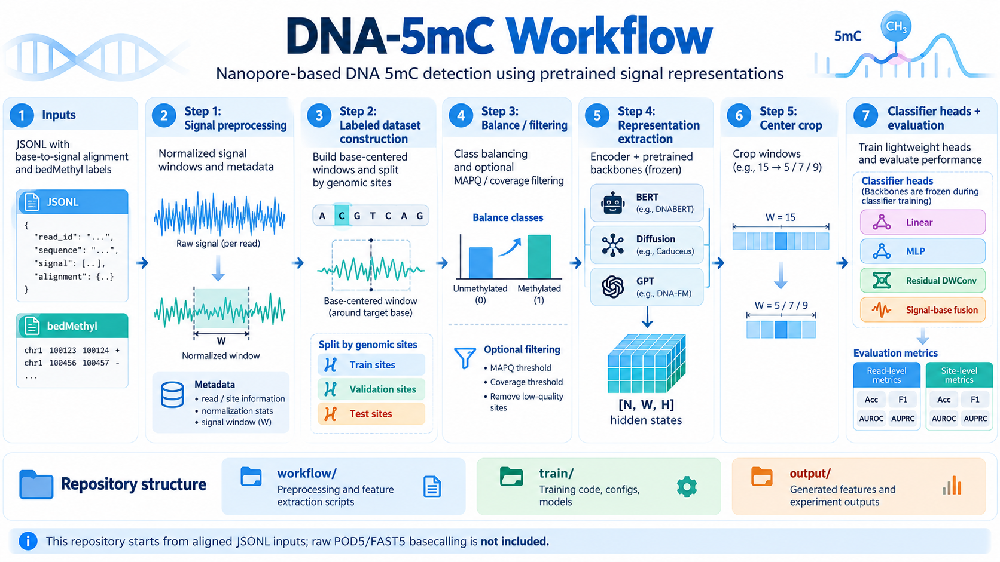

# DNA-5mC

基于 Nanopore 电流信号预训练表征的 DNA 5mC 检测项目，包含数据构建、BERT / Diffusion / GPT 特征提取、分类头训练，以及假阳性、假阴性和位点覆盖度鲁棒性评测。

**主干模型负责提取特征，训练阶段只更新分类头。** 本项目从已有的比对 JSONL 开始，不包含从 POD5/FAST5 到比对 JSONL 的完整 basecalling 流程。模型权重、原始数据、特征和实验结果需要单独准备。



```text
训练与常规测试
比对 JSONL + bedMethyl
  → 信号预处理 → 带标签窗口 → 类别平衡 / 筛选
  → encoder + BERT / Diffusion / GPT → [N, 15, H] 特征
  → 中心裁剪，例如 [N, 5, H] → 分类头训练 → read/window 与 site 指标

Test1：假阳性
已预处理的 WGA UNMOD JSONL
  → 全阴性窗口 → 对应主干特征 → 已训练分类头 → 假阳性率及分层统计
原天然 chr16 test 的 label=0 特征
  → Step1.1 同步筛选缓存 → 已训练分类头 → 天然参考阴性假阳性率

Test2：假阴性
原天然 chr16 test 的逐窗口预测
  → 选择 label=1 → read/window 与 site 漏检率 → 共同集合及 seed 比较

Test3：Coverage 鲁棒性
原天然 chr16 test 的完整正负预测
  → 固定共同 read 池和 coverage≥20 的位点
  → 共享嵌套抽取 5 / 10 / 20 reads per site
  → site 性能、低覆盖损失、抽样稳定性及模型比较
```

## 从哪里开始

| 已有材料 / 目标 | 入口 |
| --- | --- |
| 已有窗口 JSONL，提取主干特征 | [统一 Step4 配置](workflow/config/step4_config.yaml)、[提取与训练示例](#快速开始提取裁剪与训练) |
| 已有完整 Step4 特征，开始训练 | [中心裁剪与训练](#中心裁剪与训练) |
| 从全 read JSONL 和 bedMethyl 构建数据集 | [数据构建](#数据构建step1step3) |
| 用 WGA UNMOD 或天然 label=0 检查假阳性 | [Test1 假阳性评测](#test1) |
| 用天然 label=1 检查漏检 | [Test2 假阴性评测](#test2) |
| 在相同位点比较 5 / 10 / 20 条 read 的表现 | [Test3 Coverage 鲁棒性](#test3) |
| 查找参数、输出或故障原因 | [配置与路径约定](#配置与路径约定)、[输出与指标](#输出与指标)、[常见问题](#常见问题) |

本文命令在项目根目录执行；`/path/to/...` 需替换为实际路径。正式命令会处理数据；`DRY_RUN=1`、`--dry-run` 或 `--print-plan` 按各入口约定用于只读计划。Test2/Test3 优先复用训练时保存的概率，无需再次提取主干特征。

## 评测任务对照

| 任务 | 数据来源与标签 | 主要指标 | 说明 |
| --- | --- | --- | --- |
| 常规 test | 原天然 chr16，label=0/1 | Read/window、site 的 Acc、F1、AUROC、AP | 使用 valid 选择的检查点 |
| Test1：WGA | 独立 WGA UNMOD，全部 label=0 | FPR、Specificity | 阴性窗口无需 bedMethyl |
| Test1：天然阴性 | 原 chr16 test 的 label=0 | FPR、Specificity | 继承原参考阴性标签 |
| Test2：天然阳性 | 原 chr16 test 的 label=1 | FNR、Recall/TPR | 原测试集阳性子集补充分析 |
| Test3：覆盖度 | 原 chr16 test 的正负共同位点 | Site AUROC、AP、BA、F1、FPR/FNR及稳定性 | 同位点、同标签、同抽样清单比较 |

天然数据的 label=0/1 来自原 BED=0%/100% 筛选，不能仅凭标签推断逐分子实验真值；来源未独立核实时记录为 `unverified`。单类别的 Test1/Test2 不用于报告完整二分类 AUROC/AP。WGA FPR 与天然 FNR 属于不同条件，应并列报告，不能直接拼接成同一总体的混淆矩阵。

## 目录结构

```text
DNA-5mC/
├── workflow/
│   ├── paths.sh                          # 路径与 Python 环境选择
│   ├── config/step4_config.yaml          # 统一特征提取配置
│   ├── step1_preprocess_signal_jsonl.{py,sh}
│   ├── step2_build_chrom19_dataset.{py,sh}
│   ├── step3_balance_chr19.py
│   ├── step3_run_balance_chr19.sh
│   ├── step3.1_extract_chr19_small.py     # 可选：小数据集抽取
│   ├── step3.2_filter_chr19_mapq.py       # 可选：MAPQ / 覆盖度筛选
│   ├── step4_extract_features.{py,sh}    # 推荐：统一 BERT / Diffusion / GPT 入口
│   ├── step4_extract_window_hidden_states_*.{py,sh}  # 架构实现与原入口
│   └── step5_center_crop_features.{py,sh}
├── train/
│   ├── train.py                          # 分类头训练、调度和评估
│   ├── model/                            # 分类头实现
│   ├── gpu_feature_cache.py              # 已提取特征的 GPU 缓存
│   ├── wandb_tracking.py                 # 可选 W&B 记录
│   ├── run/                              # 实验 YAML 和启动脚本
│   ├── backbone/                         # 外部预训练模型或软链接
│   ├── data/                             # 裁剪后的训练特征
│   └── output/                           # 分类头权重与实验结果
├── eval/Test1/
│   ├── README.md                         # WGA 与天然参考阴性假阳性方案
│   ├── workflow/                         # WGA 流程及 Step1.1 天然阴性筛选
│   ├── data/                             # 阴性窗口与特征
│   └── output/                           # 假阳性评测结果
├── eval/Test2/
│   ├── README.md                         # 天然 chr16 参考阳性假阴性方案
│   ├── workflow/                         # config.yaml、Step1/2/3、run_all.sh
│   ├── data/                             # 可选：筛选后的阳性缓存
│   └── output/                           # FNR、分层与共同集合比较
├── eval/Test3/
│   ├── README.md                         # 5/10/20 reads per site 方案
│   ├── workflow/                         # config.yaml、Step1–5、测试及一键入口
│   └── output/<protocol_id>/             # 冻结配置、共同池、抽样、指标与图形
├── docs/assets/                          # 文档图片
└── output/
    ├── .hf_modules/                      # Hugging Face 自定义模型代码缓存
    └── ...                               # 部分脚本使用的默认中间输出
```

`chr19` 是部分脚本的历史名称，实际染色体由参数决定。外部数据也可位于 NAS 或其他磁盘；上面的目录结构不要求将所有数据复制到项目内。

## 环境与模型准备

已验证的主要运行环境为 Python 3.10、PyTorch 2.6.0、Transformers 4.48.3 和 NumPy 1.26.4；还需要 PyYAML、safetensors 及各模型自定义代码依赖。W&B 仅在启用实验记录时需要安装。Test3 图形导出需要 matplotlib，自动测试额外使用 scikit-learn 交叉核对指标；SQLite 来自 Python 标准库。

```bash
# 在包含项目依赖的 Python / Conda 环境中执行。
export PROJECT_DIR="$(pwd)"
export PYTHON_BIN="$(command -v python)"

# 检查解释器及主要依赖，不执行提取或训练。
"$PYTHON_BIN" -c 'import sys, torch, transformers, numpy, yaml; print(sys.executable); print(torch.__version__, transformers.__version__, numpy.__version__)'
```

Bash 入口通过 [paths.sh](workflow/paths.sh) 选择解释器：显式 `PYTHON_BIN` 优先，其次是激活的非 base Conda 环境，再尝试本服务器已有的 PoreDLM 环境。迁移到其他机器时，建议显式指定 `PYTHON_BIN`。

仅需准备计划使用的模型。可将模型放入 `train/backbone/`，或创建软链接：

```bash
mkdir -p "$PROJECT_DIR/train/backbone"
ln -s /path/to/V548 "$PROJECT_DIR/train/backbone/V548-BERT"
# 链接已存在时先核对目标，不要直接覆盖。
```

| 本地模型目录 | 架构 / 用途 | 需要的主要子目录 |
| --- | --- | --- |
| `V011-Diffusion` | Diffusion | `encoder/`、`hf_dlm_elf_mixed_with_cls_token_step65000-unsharded/` |
| `V543-BERT`、`V548-BERT`、`V554-BERT` | BERT | `encoder/`、`base/` |
| `V610-GPT` | GPT / OLMo | `encoder/`、`base/` |
| `V003-Preprocess` | 原 Step1 的默认预处理器 | `encoder/` |

权重、`config.json`、tokenizer 和自定义 Python 代码必须配套。统一 Step4 默认离线加载，不自动下载缺失权重；新模型版本在 YAML 的 `models` 下增加条目。已有主干参数量、架构与预训练信息核对见本地 [backbone 对比](train/backbone/compare/README.md)；该目录与模型文件一样受 Git 忽略规则影响，迁移时需另行保留。

## 快速开始：提取、裁剪与训练

### 提取主干特征

统一入口为 [step4_extract_features.sh](workflow/step4_extract_features.sh)，主要修改 [workflow/config/step4_config.yaml](workflow/config/step4_config.yaml)：

```yaml
model: V548

extraction:
  data_dir: /path/to/window_splits     # 包含 train/valid/test.jsonl.gz 或 .jsonl
  splits: [train, valid, test]
  output_root: /path/to/features      # out_dir 为 null 时，输出到此目录下的 V548/
  out_dir: null                      # 可直接指定完整的新输出目录
  device: cuda:0
  dtype: float16                     # 特征落盘精度
  limit: null                        # 正式运行保持 null；测试可设 17
```

这是需合并到完整 YAML 中的片段，保留原有 `models` 条目。当前 YAML 保存了服务器上的绝对数据路径，运行前以预览结果为准。

```bash
# 仅解析配置，核对模型路径，并显示 missing_inputs / output_exists。
DRY_RUN=1 MODEL=V548 bash workflow/step4_extract_features.sh

# 小样本提取：每个选中的 split 最多读取 17 个窗口。
# 使用独立的新目录，避免与正式特征混淆。
MODEL=V548 LIMIT=17 OUT_DIR=/path/to/new/V548_smoke \
  bash workflow/step4_extract_features.sh

# 正式提取：使用 YAML 中的数据和输出路径。
MODEL=V548 bash workflow/step4_extract_features.sh
```

设置 `MODEL=V011` 或 `MODEL=V610` 即可切换架构；`VERSION` 也是模型选择别名，同时设置时 `MODEL` 优先。只处理测试集可设 `SPLITS=test`，但训练版 Step5 和分类训练要求三个 split 齐全。

直接调用 Python 时，显式传入当前配置路径：

```bash
"$PYTHON_BIN" workflow/step4_extract_features.py \
  --config workflow/config/step4_config.yaml --model V548 --print-plan
```

输出目录必须是新目录。统一入口加载一次模型，依次处理各 split，全部成功后发布结果；同时保存实际配置和输入签名。运行中编辑 YAML 只影响后续任务，输入窗口或模型配置变化仍会报错。`limit` 非空时，汇总记录 `partial_extraction: true`。

### 中心裁剪与训练

下面使用已有的完整 Step4 特征，生成中心 5-mer 缓存及对应训练配置。裁剪保留 Step4 的上下文信息，只截取隐藏状态的位置，不重新运行主干模型。

```bash
# 指向完整 Step4 输出，包含三个 split。
export FEATURE_DIR=/path/to/features/V548
export CROP_DIR="$PROJECT_DIR/train/data/V548_center5"

INPUT_DIR="$FEATURE_DIR" OUT_DIR="$CROP_DIR" WINDOW_SIZE=5 \
TRAIN_CONFIG="$PROJECT_DIR/train/run/example/config.yaml" EXPERIMENT=V548-center5 \
  bash workflow/step5_center_crop_features.sh

# 使用刚生成的配置，避免目录名和手工修改的训练配置不一致。
# --dry-run 校验实际输入和任务，不训练、不写实验结果。
"$PYTHON_BIN" train/train.py --config "$CROP_DIR/train_config.yaml" --dry-run

# 小规模训练：一个分类头、一个 seed、最多两轮，另设实验名称。
WANDB_MODE=offline "$PYTHON_BIN" train/train.py \
  --config "$CROP_DIR/train_config.yaml" \
  --strategies center_5mer_mlp_raw768 --seeds 1 --device cuda:0 \
  --epochs 2 --experiment V548-center5-smoke

# 完整训练：采用生成配置中的策略、seed、设备及早停设置。
WANDB_MODE=offline "$PYTHON_BIN" train/train.py --config "$CROP_DIR/train_config.yaml"
```

`TRAIN_CONFIG` 是训练模板，Step5 会生成新的 `train_config.yaml`，不会修改模板。`WINDOW_SIZE` 可选 5、7、9 等不超过输入长度的奇数；更改时也应更换输出目录。

名称含 `center_5mer` 的 Linear、Gaussian Pool、Learned Pool、MLP、DWConv 头固定取中心 5 个位置；`center_base` 只取中心位置。融合头通过 `fusion_window_size` 控制窗口，适合比较不同裁剪长度。具体模型结构见 [train/model](train/model)。

## 配置与路径约定

| 配置 / 入口 | 路径解析方式 |
| --- | --- |
| 统一 Step4 YAML | 相对路径以项目根目录为基准 |
| 统一 Step4 的 CLI / 环境变量路径 | 相对路径以启动目录为基准 |
| `train/run/*/config.yaml` | 相对路径以 `train/` 为基准；不取决于 YAML 所在目录 |
| Test1 提取配置 | 使用独立的 [eval/Test1/workflow/config.yaml](eval/Test1/workflow/config.yaml)，相对路径以项目根目录为基准 |
| Test2 评测配置 | [eval/Test2/workflow/config.yaml](eval/Test2/workflow/config.yaml)，模型、特征与结果根目录使用绝对路径；`CONFIG` 可切换配置 |
| Test3 协议配置 | [eval/Test3/workflow/config.yaml](eval/Test3/workflow/config.yaml)，模型及输出路径使用绝对路径；`CONFIG` / `PROTOCOL_DIR` 可覆盖 |

统一 Step4 的优先级为：**CLI > 显式环境变量 > 当前模型条目 > `extraction` > 默认值**。`EXTRACTION_CONFIG` 可指定另一份 YAML。

`OUTPUT_ROOT` 在原工作流中是中间输出根目录，在统一 Step4 中是特征根目录。单步运行应明确设置对应的输入、输出参数；它不会自动改写训练 YAML 或三个评测目录的配置。Test3 在 Step1 冻结完整配置与 run 清单，后续更改参数需建立新协议目录。

### 隐藏层与性能参数

| 参数 | 作用 |
| --- | --- |
| BERT `hidden_layer` | `hidden_states` 索引：0 为 embedding，1 为首层输出，-1 为最后 Transformer 层输出 |
| Diffusion `hidden_source` | `ode_hidden`、`context_hidden`、`last_hidden` 等；V011 默认 ODE 起点 0.97、1 步、CFG 0.5 |
| GPT `decoder_layers` | `last`、`embed` 或从 0 开始的 Transformer 层编号；多选时还需明确 `selected_layer_name` |
| `batch_size` | 主干推理批次；当前统一配置中 BERT 为 8，Diffusion/GPT 为 32，模型条目可覆盖 |
| `dtype` | 仅控制缓存落盘精度，不将主干推理自动切换为 FP16 |
| `pooling_device` | `model` 在模型设备上按原 span 做 FP32 聚合后传回 CPU；`cpu` 保留原 CPU 聚合 |
| `codec_batch_size` | 默认 1，逐条编码；大于 1 时按等长信号批量编码 |
| `codec_buffer_size` | 等长分组缓冲窗口数，只在批量 codec 启用时使用 |

不同主干的 token 映射、特殊 token 和隐藏层语义不同，应保持与对应训练特征一致。改变这些参数后，需要使用匹配的特征重新训练分类头。

GPU 聚合会因求和顺序产生微小浮点差异；批量 codec 的卷积舍入差异可能进一步改变离散 token，已有真实小样本测试观察到该现象，因此正式对比默认保留 `codec_batch_size: 1`。当前实现未通过额外降低主干精度来提速。

原 [BERT](workflow/step4_extract_window_hidden_states_BERT-js.sh)、[Diffusion](workflow/step4_extract_window_hidden_states_Diffusion-kx.sh)、[GPT](workflow/step4_extract_window_hidden_states_GPT.sh) 入口仍可使用，其默认输出路径、批次和 dtype 与统一入口可能不同。

### `output/.hf_modules` 是什么

该目录由 Transformers 加载本地自定义模型代码时自动生成，位置由 `HF_MODULES_CACHE` 控制。里面的 `modeling_pore_codec.py`、`modeling_bert.py` 等是代码缓存，**不代表已生成特征或训练结果**。

原始模型代码位于 `train/backbone/<模型>/encoder/` 或主干 checkpoint 目录中；不要把缓存副本作为正式修改来源。仅存在 `.hf_modules` 时，说明发生过模型代码加载，不能据此判断提取是否完成。

## 数据构建：Step1–Step3

### Step1：预处理全 read 信号

输入需包含信号、序列、比对及碱基—信号对应信息。Step1 使用模型预处理器处理 `signal`，保留其他字段，并可检查处理前后的信号长度。

```bash
INPUT_FILE=/path/to/reads.genome_signal.jsonl \
OUTPUT_FILE="$PROJECT_DIR/output/step1_output/reads.preprocessed.jsonl" \
MODEL_DIR="$PROJECT_DIR/train/backbone/V003-Preprocess/encoder" MODE=single \
  bash workflow/step1_preprocess_signal_jsonl.sh
```

可先加 `LIMIT=10000` 小规模检查；`MODE=shard JOBS=4` 用于分片并行。输入已经预处理时，先核对处理方式及信号坐标，再决定是否跳过 Step1，避免重复归一化。

### Step2：根据 bedMethyl 构建窗口与标签

训练用 [Step2](workflow/step2_build_chrom19_dataset.py) 从同一输入 JSONL 和 bedMethyl 生成两类窗口：

- 默认中心参考碱基为 C，使用正链 read 和正链 BED、修饰类型 `m`。
- bedMethyl 修饰百分比为 100 的位点标记为 1，为 0 的标记为 0；中间值不进入数据集。
- 默认左右各 7 个碱基，共 15 nt；检查 query/reference 一致性和信号跨度。
- 分别限制 BED 覆盖度、提取后实际位点覆盖度和 read MAPQ。
- train/valid 按染色体与中心位点确定性划分；`--test-only` 将保留窗口全部写入 test。

以下示例以 chr19 构建 train/valid，以 chr16 构建按染色体留出的 test。覆盖度及 MAPQ 是示例实验设置。

```bash
GENOME_JSONL=/path/to/reads.preprocessed.jsonl
BED_METHYL=/path/to/labels.bed.gz

"$PYTHON_BIN" workflow/step2_build_chrom19_dataset.py \
  --jsonl "$GENOME_JSONL" --bed-gz "$BED_METHYL" \
  --out-dir "$PROJECT_DIR/output/step2_output/chr19_cov10" \
  --chrom chr19 --flank 7 --min-coverage 10 --min-actual-coverage 10 \
  --min-mapq 30 --train-ratio 0.9 --valid-ratio 0.1

"$PYTHON_BIN" workflow/step2_build_chrom19_dataset.py \
  --jsonl "$GENOME_JSONL" --bed-gz "$BED_METHYL" \
  --out-dir "$PROJECT_DIR/output/step2_output/chr16_cov20_test" \
  --chrom chr16 --flank 7 --min-coverage 20 --min-actual-coverage 20 \
  --min-mapq 30 --test-only
```

[Step2 Shell](workflow/step2_build_chrom19_dataset.sh) 当前预设为 chr16、覆盖度 20、test-only；只改染色体不会取消 test-only，因此上例直接调用 Python。

除 `signal`、`seq`、`chrom`、`strand`、`mapq` 和原始 read ID 外，上游 JSONL 还需有 `base_sample_span_seq` 与 `per_base`；其中包含参考位置、query 位置、信号跨度及 query/reference 碱基等映射。仅有序列和信号数组不足以构建这些窗口。

### Step3：平衡、筛选与汇集 split

[类别平衡](workflow/step3_run_balance_chr19.sh) 按窗口数平衡两类，同时维持最小位点覆盖度，保持原 split 归属。输入应是完整 Step2 输出目录，保留清单和校验信息。

```bash
INPUT_DIR="$PROJECT_DIR/output/step2_output/chr19_cov10" \
OUT_DIR="$PROJECT_DIR/output/step3_output/chr19" MIN_COVERAGE=10 SPLITS="train valid" \
  bash workflow/step3_run_balance_chr19.sh

INPUT_DIR="$PROJECT_DIR/output/step2_output/chr16_cov20_test" \
OUT_DIR="$PROJECT_DIR/output/step3_output/chr16" MIN_COVERAGE=20 SPLITS=test \
  bash workflow/step3_run_balance_chr19.sh

# 将三个 split 汇集到 Step4 的同一个输入目录。
mkdir -p "$PROJECT_DIR/output/step3_output/new"
ln -s "$PROJECT_DIR/output/step3_output/chr19/train.jsonl.gz" "$PROJECT_DIR/output/step3_output/new/train.jsonl.gz"
ln -s "$PROJECT_DIR/output/step3_output/chr19/valid.jsonl.gz" "$PROJECT_DIR/output/step3_output/new/valid.jsonl.gz"
ln -s "$PROJECT_DIR/output/step3_output/chr16/test.jsonl.gz" "$PROJECT_DIR/output/step3_output/new/test.jsonl.gz"
```

`SITE_POLICY=auto` 必要时允许移除部分多数类位点；`preserve_all` 要求保留全部位点，无法同时平衡时会报错。可选 [Step3.1](workflow/step3.1_extract_chr19_small.py) 抽取小数据集、[Step3.2](workflow/step3.2_filter_chr19_mapq.py) 提高 MAPQ / 实际覆盖度要求。筛选后的类别比例需重新核对。

## 分类头、训练与早停

完整参数见 [train/run/example/config.yaml](train/run/example/config.yaml)。各实验配置经常调整，不在 README 固定其 seed、轮数或 GPU 列表；请核对 YAML 中的 `feature_dir`、`experiment`、`strategies`、`seeds`、`devices` 和 `training`。

**目录名不决定训练内容。** 实验模板可能被复用，运行前应检查 YAML 中实际的 `feature_dir`、`experiment` 与分类头清单，或使用 Step5 生成的 `train_config.yaml`。训练结果中的 `config.json` 才是对应 run 的实际配置；本 README 不固定经常调整的目录映射。

| `strategy` | 输入与结构 |
| --- | --- |
| `center_base_linear_raw768` | 中心碱基表征，LayerNorm + Linear |
| `center_5mer_linear_raw768` | 中心 5 个表征，归一化后展开 + Linear |
| `center_5mer_gaussian_pool_linear_raw768` | 固定高斯位置权重池化 + Linear |
| `center_5mer_learned_pool_linear_raw768` | 可学习的全局位置权重池化 + Linear |
| `center_5mer_mlp_raw768` | 中心 5 个表征，MLP |
| `center_5mer_residual_dwconv_raw768` | 中心 5 个表征，残差深度卷积分类头 |
| `center_5mer_emb8_none` | 信号分支 + 8 维碱基 Embedding，BiLSTM 融合 |

`raw768` 是历史策略名称，实际维度从特征读取。融合头的碱基由 `base_source: ref/seq` 决定，不需要额外统计量 TSV。

- **任务调度**：每个“分类头 × seed”为独立任务；`devices: [cuda:0, cuda:1]` 在多 GPU 上调度任务，不是单个模型的 DDP。`--device cuda:0` 可覆盖多卡配置。
- **早停**：每轮检查 valid 的 read/window 指标。默认监控 AUROC，连续 `patience` 轮没有严格提升则早停；相同分数也计为未提升。指标不可计算时回退到验证 loss，loss 越低越好。
- **最佳权重**：最终 valid/test 评估使用最佳验证轮次的 `best.pt`；它不是包含完整优化器状态的断点续训文件。
- **阈值**：`training.threshold` 默认 0.5，影响 accuracy、F1 和混淆矩阵，不影响 AUROC/AUPRC。阈值选择使用 valid，随后固定用于 test。
- **数据检查**：`check_site_overlap` 检查染色体和中心位点是否跨 split 重叠；标签、特征和 TSV 行数必须一致。
- **完成任务复用**：`skip_completed` 会核对配置、输入签名和代码，条件匹配才跳过完整结果；新实验使用新的 `experiment`。

### 读取性能与 W&B

`batch_read` 用于批量读取 memmap；`num_workers` 和 `eval_num_workers` 分别控制训练与评估的数据加载。先看日志中的 `data_wait_s`，再判断是否需要调整读取方式或 worker 数。

`training.gpu_cache` 可将已提取的特征缓存到 GPU，供多个训练 epoch 复用；可配置缓存 split、容量上限、预留显存及不足时回退。它与 Step4 的主干推理加速是不同阶段，不能直接省去 encoder/主干计算。实现见 [gpu_feature_cache.py](train/gpu_feature_cache.py)。

W&B 由 [wandb_tracking.py](train/wandb_tracking.py) 管理，每个分类头/seed 对应一个 run。其他账号应修改 YAML 中的 `wandb.entity`；`WANDB_MODE=offline` 可保存离线记录。若无需 W&B，设置 `wandb.enabled: false`，此时无需安装 SDK。离线模式仍需 SDK。

## 输出与指标

### 特征缓存

```text
<Step4 输出目录>/
├── train.pt / valid.pt / test.pt        # streaming_memmap_v1 清单
├── train.features.f16.bin              # float32 时为 .f32.bin；其他 split 同理
├── train.labels.f32.bin
├── metadata_train.tsv                  # 每行对应一个窗口
├── ...
├── feature_summary.json
└── resolved_extraction_config.json     # 统一入口实际使用的配置
```

特征形状为 `[N, W, H]`：窗口数、碱基位置数、隐藏维度。移动缓存时应整体保留 `.pt`、`.bin` 和 TSV；仅复制 `.pt` 无法训练。`.partial` 文件不是已完成结果。

### 分类训练结果

```text
train/output/<experiment>/
├── scheduling.json
├── summary.tsv                         # 每个分类头 / seed 的指标
├── aggregate.tsv                       # 跨 seed 的均值、样本标准差和方差
└── runs/<strategy>_seed<N>/
    ├── resolved_config.yaml / config.json
    ├── train.log / history.jsonl
    ├── best.pt
    ├── metrics.json
    ├── test_predictions.tsv            # 开启预测保存时
    └── test_site_predictions.tsv
```

| 层面 | 样本 / 聚合定义 | 主要指标 |
| --- | --- | --- |
| Read/window | 一个导出的 read-window；不等于一条唯一的完整 read | Accuracy、F1、AUROC、AUPRC、loss、混淆矩阵 |
| Site | 按 `chrom + center_genome_pos0 + strand + source` 分组，取窗口概率算术均值 | Accuracy、F1、AUROC、AUPRC |

AUPRC 在代码中按 average precision 计算。跨 seed 的标准差/方差使用 `ddof=1`，表示训练随机种子的变动，不是独立生物重复的变动。`evaluate_train: true` 可增加 train 的最终评估；valid/test 始终评估。

<a id="test1"></a>

## Test1：假阳性评测

方案见 [eval/Test1/README.md](eval/Test1/README.md)，脚本说明见 [eval/Test1/workflow/README.md](eval/Test1/workflow/README.md)。两条分支均保留 label=0，但阴性依据不同，结果分开命名和解释。

### WGA UNMOD 阴性对照

以 WGA 实验文库身份作为阴性依据，所有窗口标记为 0，构建窗口时不需要 bedMethyl。

| Test1 步骤 | 功能 |
| --- | --- |
| Step1 | 从已预处理的全 read JSONL 提取正链窗口，去重、计算位点覆盖度并保存审计索引 |
| Step2 | 按独立配置提取 test 特征，并补充文库和质量字段 |
| Step3 | 可选：裁剪中心窗口；评测器也支持读取较宽特征后按分类头要求中心裁剪 |
| Step4 | 加载已训练的 `best.pt`，计算 read/site 假阳性，不训练模型 |
| Step5 | 汇总 seed，并匹配不同模型共同保留的样本 |

```bash
# 预览 Test1 特征提取配置，与训练版 Step4 配置相互独立。
VERSION=V610 DRY_RUN=1 bash eval/Test1/workflow/step2_extract_features.sh

# 已有阴性特征和分类头时评测；四个路径/版本参数应一起匹配。
VERSION=V610 RUNS_ROOT="$PROJECT_DIR/train/output/V610-v2" \
CROPPED_DIR=/path/to/Test1/features/V610 RESULTS_DIR=/path/to/new/Test1/results/V610 \
DEVICE=cuda:0 bash eval/Test1/workflow/step4_evaluate.sh
```

约 5× 总体测序深度不等于每个位点恰好 5 条 read，应使用实际覆盖度。报告 `FPR = FP / (FP + TN)`、specificity、样本数及覆盖度/序列上下文分层；全阴性集合无法估计对阳性样本的灵敏度或有意义的二分类 AUROC。

`coverage_metrics.tsv` 是 **site-level** 覆盖度分层，不应直接解释为 read-level FPR；累计覆盖度筛选结果见 `metrics.json` 的 `min_coverage`。比较模型时固定阈值、覆盖度范围、文库和样本集合，避免将不同过滤条件混在同一张表中。

Test1 的 Shell 保存了具体实验路径，切换 `VERSION` 时需要同步特征、训练结果和输出路径。当前 `run_all.sh --test` 引用的 `test_step2_config.py` 不在工作区中，不能把它视为已可用的一键自测入口；可先逐步使用配置预览和受限小样本检查。

### 天然 chr16 参考阴性

[Step1.1](eval/Test1/workflow/step1.1_build_native_negatives.sh) 从对应主干的原 test 缓存中同步筛选 `label=0`，保留特征字节、参考标签、文库及原行号。它是 WGA 数据构建的平行分支，生成缓存后直接进入 Test1 Step4，无需再提取主干或中心裁剪。

```bash
# 只读核对原缓存和阴性数量，估算输出空间。
VERSION=V011 INPUT_DIR="$PROJECT_DIR/train/data/V011-V2" \
OUT_DIR=/path/to/new/native_bed0/V011 DRY_RUN=1 \
  bash eval/Test1/workflow/step1.1_build_native_negatives.sh

# 已构造天然阴性缓存后，用对应分类头评测。
VERSION=V011 RUNS_ROOT="$PROJECT_DIR/train/output/V011-v2" \
CROPPED_DIR=/path/to/native_bed0/V011 RESULTS_DIR=/path/to/new/native_bed0_results/V011 \
DEVICE=cpu bash eval/Test1/workflow/step4_evaluate.sh
```

该结果表示相对于原 BED=0 参考标签的 FPR，不等同于 WGA 实验阴性 FPR。`library_id` 使用原天然文库 ID，同文库在 Test2/Test3 和不同主干之间保持一致。

<a id="test2"></a>

## Test2：天然参考阳性假阴性评测

方案见 [eval/Test2/README.md](eval/Test2/README.md)，操作见 [workflow/README.md](eval/Test2/workflow/README.md)，统一配置为 [config.yaml](eval/Test2/workflow/config.yaml)。

从原天然 chr16 test 选择 `label=1`，保留原始正类概率，报告 `FNR = FN / (TP + FN)` 和 `Recall = 1 - FNR`。默认同时报告全部阳性及最终 coverage≥5 子集，并输出上下文、覆盖度、阈值分层和漏检清单。

| 步骤 | 作用 |
| --- | --- |
| Step1 | 可选：构造全阳性特征缓存，仅重新推理路线需要 |
| Step2 | `predictions` 复用已有预测；或 `features` 加载匹配的分类头重新推理 |
| Step3 | 原始/共同观测分别比较，重算 site coverage，汇总实际训练 seed |

推荐默认 `evaluation.source: predictions`，无需 GPU，也无需 Step1：

```bash
# 只读列出将处理的 run 与输出目录。
bash eval/Test2/workflow/run_all.sh --dry-run

# 核对配置后执行：Step2 汇总已有预测，Step3 比较。
bash eval/Test2/workflow/run_all.sh --run

# 也可只预览一个模型的 Step2。
VERSION=V011 DRY_RUN=1 bash eval/Test2/workflow/step2_evaluate.sh
```

只选择一个 run 时，可使用 `VERSION` 和 `RUN_DIR`；比较范围还需在 YAML 的 `enabled_versions / evaluation.strategies / evaluation.seeds` 中一致限定。空 seed 列表选择全部已完成 seed，支持 1/2/3、4/5/6 等。重新推理使用 `evaluation.source: features`，详见操作文档；两条路线应使用不同的新结果目录。

主要输出为每个 run 的 `metrics.json`、FN 窗口/位点清单、`context_metrics.tsv`、`coverage_metrics.tsv`、`run_manifest.json`，以及比较目录下的 `raw_summary.tsv`、`common_summary.tsv` 和 `common_aggregate.tsv`。

当前工作区缺少 `eval/Test2/workflow/test_workflow.py`，其一键入口默认模式及 `--test` 暂不可用；上面的 `--dry-run` 和 `--run` 是独立分支。

<a id="test3"></a>

## Test3：Coverage 鲁棒性

方案见 [eval/Test3/README.md](eval/Test3/README.md)，操作见 [workflow/README.md](eval/Test3/workflow/README.md)，统一配置为 [config.yaml](eval/Test3/workflow/config.yaml)。

**5× / 10× / 20× 在这里表示每个位点恰好抽取 5 / 10 / 20 条不同 read。** 它与 Test1 约5×总体测序深度的 WGA 文库不是同一个定义，也不模拟整条染色体重新低深度测序。

主实验同时使用原 test 正负两类。先匹配所有选定主干、分类头、训练 seed 的共同 read–位点观测，再固定共同 coverage≥20 的位点。所有深度保持相同位点、标签和正负比例；不能按深度分别筛选位点。

| 步骤 | 作用 |
| --- | --- |
| Step1 | 冻结配置/run 清单，审计完整正负预测；每主干一份观测索引、每 run 一份概率向量 |
| Step2 | 构建全局共同 read 池，固定满足最大深度的位点；可选一次性1:1类别平衡 |
| Step3 | 每个位点/重复生成共享排名，无放回嵌套抽样，满足 `5 ⊂ 10 ⊂ 20` |
| Step4 | float64 平均概率汇总，计算各深度性能、Full-common 基线及逐位点稳定性 |
| Step5 | 汇总训练/抽样变动、配对深度损失、模型差值、区块区间与 PNG/PDF 曲线 |

默认复用 `test_predictions.tsv`，50次抽样；核心配置示例：

```yaml
# 完整配置中的节选；保留其余必需字段和 models 路径。
enabled_versions: [V011, V543, V554, V610]
prediction_source: saved
minimum_common_reads: 20
depths: [5, 10, 20]
repeats: 50
sampling_seed: 20261018
site_balance: none              # 主分析保留全部合格位点；equal 为严格1:1补充实验
site_threshold: 0.5
```

```bash
# 临时 CPU 自测：验证抽样、平衡、指标、输入审计、汇总和图形导出。
bash eval/Test3/workflow/run_all.sh --test

# 五步只读计划，不生成正式结果。
bash eval/Test3/workflow/run_all.sh --dry-run

# 核对 YAML 后正式运行；结果写入其 output_dir。
bash eval/Test3/workflow/run_all.sh --run

# 前3步已完成且配置不变时，从Step4继续。
bash eval/Test3/workflow/run_all.sh --run --from-step 4
```

Step4若已有部分 run 完成，应通过 `VERSION / RUN_NAME` 只处理缺少的任务，之后再执行Step5。已有目录拒绝覆盖；`CONFIG` 或 `--config` 可切换完整配置，`PROTOCOL_DIR` 或 `--protocol-dir` 可指定协议根目录，各步骤必须一致。

主要汇总位于 `<output_dir>/summary/`：

| 输出 | 内容 |
| --- | --- |
| `model_summary.tsv` | Site AUROC、AP、BA、F1、FPR/FNR等均值，训练seed SD与抽样范围分别报告 |
| `depth_differences.tsv` | 相对20条read的低深度性能损失 |
| `model_differences.tsv` | 相同位点和抽样清单上的模型差值，训练seed配对信息另列 |
| `full_common_summary.tsv` | 固定位点使用全部共同read的辅助基线 |
| `stability_summary.tsv` | 位点分数波动、调用不稳定性、错误频率等 |
| `figures/` | AUROC、BA、FPR/FNR随read数变化的PNG/PDF |

`site_balance: none` 保留全部合格位点；严格1:1补充实验设置 `equal` 并使用新协议目录。等量位点只选一次，所有模型、深度和重复共用，不复制 read 或每次重新平衡。

抽样范围、训练 seed SD 和基因组区块区间分别解释。默认区块 CI 用于 BA/FPR/FNR；AUROC/AP不通过平均区块分数计算区间。50次抽样复用同一有限 read 池，不是50份独立生物样本。该分析主要检验已有窗口概率的位点汇总鲁棒性。

## 评测前核对

- **模型与数据匹配**：各主干使用自身特征和分类头；已有预测需对应冻结的检查点和参考标签。
- **分母与阈值固定**：比较时匹配共同观测，再计算coverage；阈值在valid/独立校准数据上确定，不用Test1/2/3挑最佳seed或工作点。
- **明确测试状态**：`partial_test / partial_extraction` 标记限量数据。小前缀的位点可能只有1条read，不能当作真实5/10/20覆盖度实验。
- **测试入口可用性**：Test3提供18项临时CPU测试；Test1/Test2当前缺少各自入口引用的测试文件，先使用可用的逐步计划检查。
- **存储与复现**：Test3优先复用概率，不为每个depth/repeat复制特征；保留实际配置、输入签名、共同位点、抽样和权重哈希。旧预测未嵌入检查点SHA256时，来源一致性核对不等于证明其历史生成过程。

## 常见问题

| 现象 | 检查方式 |
| --- | --- |
| 找不到 Step4 配置 | 当前 YAML 在 `workflow/config/step4_config.yaml`。Shell 已使用该路径；直接调用 Python 应显式传 `--config`，其代码默认路径仍是旧位置。 |
| 模型或数据路径不存在 | 核对软链接目标、YAML 绝对路径，以及 `DNA-5mC` / `DNA-5mc` 的大小写；克隆代码不会恢复外部文件。 |
| `No module named torch/numpy` | 核对 `PYTHON_BIN` 和实际 Conda 环境，不能仅依据终端显示的环境名称。 |
| `No space left on device` | 检查输出目录所在文件系统的空间和 inode：`df -h /path/to/output`、`df -i /path/to/output`；这是磁盘写入问题。 |
| CUDA OOM | 区分主干推理批次、分类头训练批次和 GPU 特征缓存容量，调整对应参数。 |
| `devices` 解析错误 | YAML 列表元素需用逗号分隔，例如 `[cuda:0, cuda:1]`。 |
| 裁剪提示输入发生变化 | 源特征、TSV 和模板 YAML 都可能被检查；保持输入稳定，使用最终成功提示判断是否完成。 |
| 启动后暂时没有训练 step | 启动阶段可能正在检查清单、元数据和跨 split 位点；先查看日志阶段。 |
| 不同主干的样本数不一致 | 检查 Step4 的跳过、超长和截断统计，比较时匹配共同窗口/位点。 |
| Test2 `--test` 提示文件不存在 | 当前缺少 `eval/Test2/workflow/test_workflow.py`；用 `--dry-run` 核对现有评测配置。 |
| Test3 提示配置已变化 | Step1 已冻结完整配置；恢复原配置继续后序步骤，或使用新的协议目录。 |
| Test3 小样本没有 coverage≥20 的位点 | `MAX_RECORDS` 限制的是原始输入行，未保留某个位点的完整read；增加真实覆盖，或仅在隔离配置中降低深度做接口联调。 |
| 评测输出目录已存在 | 使用新结果/协议目录；部分任务完成时按各入口的单run筛选继续，避免覆盖已完成结果。 |

`DRY_RUN=1 bash ...` 通常只预览；训练入口的 `--dry-run` 会读取真实输入并检查任务，大数据下仍可能耗时。统一 Step4 的 `--print-plan` 解析配置和模型配置路径，但不加载权重。

`.gitignore` 排除了模型、特征、权重、日志和运行结果。迁移环境时，应另外保存数据与模型位置、实际配置、split 信息及结果清单，不能仅依赖 Git 中的代码。
